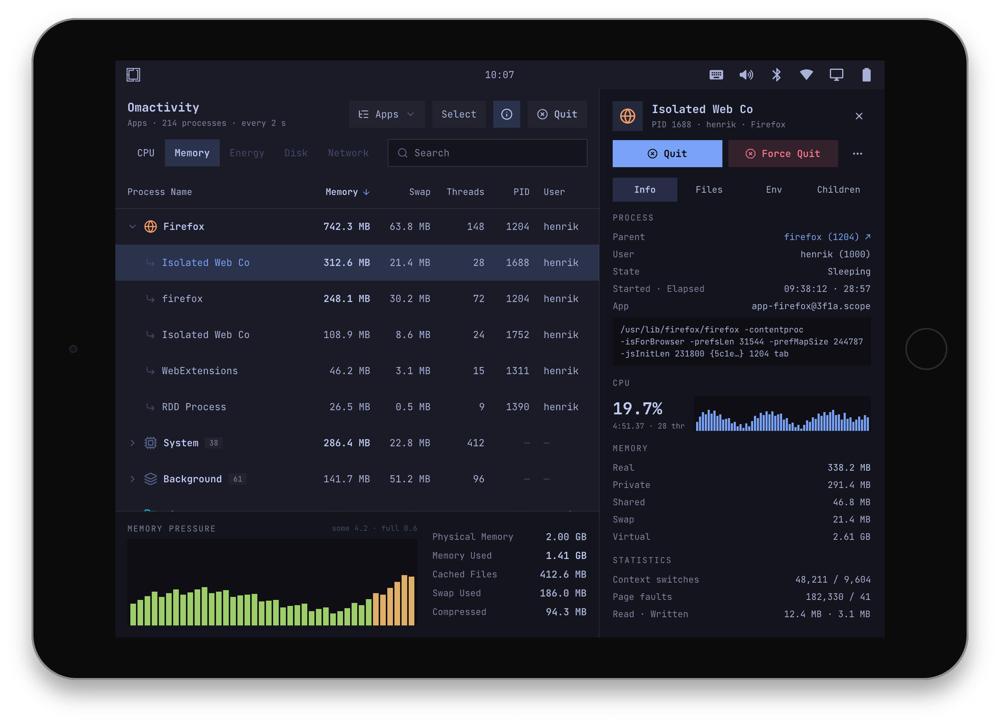
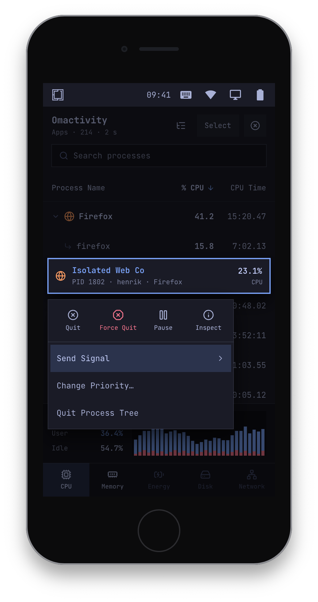

# Omactivity

  
  

A touch-first task manager for Omarchy: find any process by name, see the
process tree, sort by CPU or memory, inspect a process, and quit or
force-quit it. It is built for tablets and phones (Omarchy A) and works
with a keyboard and mouse too. [SPEC.md](SPEC.md) is the design; the
mockups are in [mockups/](mockups).

Qt 6 and C++, one process, opened on demand. Nothing runs while it is
closed. It reads `/proc` and `/sys`, signals your own processes directly
and root's or other users' through `sudo`.

## Build

Needs `qt6-base` (with Qt D-Bus), `qt6-declarative`, a C++17 compiler and, for closing app
windows through the compositor, `wayland` (libwayland-client and
wayland-scanner). Without wayland-scanner it still builds; Quit then starts
at SIGTERM.

    mkdir build && cd build
    qmake6 ../omactivity.pro
    make
    ./omactivity

`make install` puts the binary in `/usr/bin`, the desktop file and icon in
`/usr/share`, and the protected-process list in `/etc/omactivity`.

## Tests

    bin/test

Builds and runs the unit tests: no device and no display needed. They run
the collector, the list, the inspector and the theme reader against the
recorded `/proc` tree in `tests/fixtures`, and signal real processes that
the tests start themselves.

The fixture is a recording of a headless Linux VM (`tests/record-proc`)
with a small scripted desktop session on top (`tests/make-fixture` says
exactly what is recorded and what is chosen).

## Working on it from macOS

`dev/` has a container with the same Qt the package builds against:

    podman build -t localhost/omactivity-dev -f dev/Containerfile dev
    dev/run                 # build into build/
    dev/run bin/test        # unit tests
    dev/run dev/sudo-check  # the sudo password path, against the real sudo
    podman run --rm -i --systemd=always -v "$PWD:/src" -w /src localhost/omactivity-dev sh dev/window-check
                            # Quit closes a window through a real (headless) labwc
    OMACTIVITY_USER=1000 dev/run dev/shot build/shots/tablet.png 1024x768 "tab:memory,expand:Firefox,inspect:Isolated Web Co"

`dev/shot` saves a picture of the app showing the fixture, in a given
window size and state, drawn by Qt's software renderer (what Omarchy A uses
on boards without a GPU).

## Package and releases

`pkgbuild/` builds the Arch Linux ARM (aarch64) package from the checkout,
in the container image pinned in `pkgbuild/image`:

    podman run --rm -v "$PWD:/src" "$(cat pkgbuild/image)" /src/pkgbuild/build

The package and its `SHA256SUMS` land in `dist/`. CI does exactly this on
every push and pull request, tests included.

A release is a tag `vX.Y.Z` that matches the version in `omactivity.pro`
and `pkgbuild/PKGBUILD`. For a tag, CI also signs a build attestation
(which commit and workflow produced the file) and drafts a GitHub release
with the package, `SHA256SUMS` and the attestation bundle; a maintainer
publishes the draft.

To check a downloaded package:

    sha256sum -c SHA256SUMS
    gh attestation verify omactivity-*.pkg.tar.zst --repo OrchardLinux/omactivity

A distro pins the release's download URL and checksum.

## How it fits into a system

- **Apps view.** An app is a systemd user scope: `app-<id>@<x>.scope` or
  `app-<id>-<random>.scope` in `/proc/PID/cgroup`. The launcher has to
  start apps that way (`systemd-run --user --scope`, or `uwsm-app`). The
  name and icon come from `<id>.desktop`. Without scopes, everything shows
  under System and Background.
- **Quit** asks the compositor to close the app's windows
  (wlr-foreign-toplevel-management: labwc, Hyprland), then sends SIGTERM
  after 5 s, then offers Force Quit after 5 more.
- **Theme.** The look follows [Folio](https://github.com/omacom/folio),
  Omarchy's file manager: the palette of
  `~/.local/state/omarchy/current/theme/colors.toml` (or
  `~/.config/omarchy/current/theme`), fills instead of outlines, the
  `monospace` family at 13 px. Corners follow Hyprland's window rounding and
  are square elsewhere. Reloaded when the theme changes.
- **Protected processes.** `/etc/omactivity/protected.conf` lists the
  processes whose loss takes the session down. Acting on one asks first and
  says what will happen. A distro adds its own lines.
- **Settings** are in `~/.config/omactivity/omactivity.conf`.

`omactivity --tab memory` opens on the Memory tab (for a bar meter); the tabs are `cpu`, `memory`, `energy`, `disk` and `network`.

## Layout

    src/procfs.*        /proc and /sys text parsing
    src/sampler.*       one pass over /proc, diffed against the last
    src/collector.*     the sampler on its own thread and timer
    src/processmodel.*  the list: views, search, sort, tree, selection
    src/inspector.*     one process in detail
    src/actions.*       quit, force quit, signals, priority, sudo
    src/toplevels.*     the compositor's window list
    src/inhibitors.*    who keeps the device awake (logind)
    src/painteditems.*  icons and line graphs
    src/theme.*         the Omarchy theme
    qml/                the interface
    data/               desktop file, icon, protected.conf
    pkgbuild/           the package recipe, its build script and container image
    tests/              unit tests and the recorded /proc tree

## License

MIT. `protocols/wlr-foreign-toplevel-management-unstable-v1.xml` carries its
own notice.
